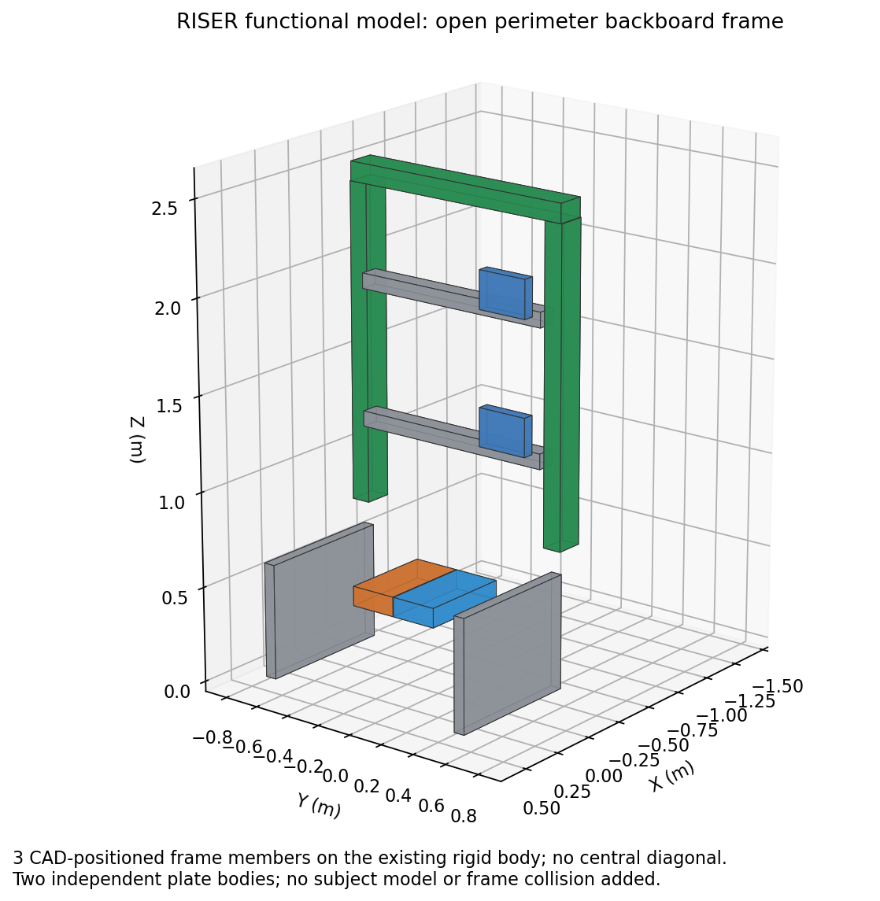

# RISER control

ROS 2 simulation and control interfaces for the RISER balance robot. The model
has independently driven backboard and foot-platform pitch, coordinated torso
and hip lateral slides, and two force plates. Gazebo applies physical joint
torques and forces, with gravity, inertia and plate contact enabled.



## Build

Requires Ubuntu 24.04, ROS 2 Jazzy and Gazebo Harmonic binary packages.
Build from the repository root:

```bash
source /opt/ros/jazzy/setup.bash
rosdep install --from-paths src --ignore-src -y
colcon build --cmake-args -DCMAKE_BUILD_TYPE=Release
source install/setup.bash
```

In each additional terminal, source ROS and `install/setup.bash`.

## Explore

Start Gazebo with the position controller:

```bash
ros2 launch riser_bringup control.launch.py backend:=gazebo plot:=false
# Without the Gazebo GUI:
ros2 launch riser_bringup control.launch.py backend:=gazebo headless:=true plot:=false wrench_input:=false
```

Run one launch at a time; stop it with Ctrl+C before starting another. `plot:=false`
disables the optional PlotJuggler window, which launch otherwise opens by default.
`wrench_input:=false` disables the optional subject wrench GUI for headless runs.
For a kinematic preview with sliders, use
`ros2 launch riser_bringup view.launch.py`. For controller experiments without
physics, use `control.launch.py backend:=mock plot:=false`.

In a second sourced terminal, inspect the active controllers and move all three
coordinates slightly over five simulated seconds:

```bash
ros2 control list_controllers
ros2 topic pub --once /riser_position_controller/joint_trajectory trajectory_msgs/msg/JointTrajectory \
  '{joint_names: [backboard_pitch, foot_plate_pitch, ml_angle], points: [{positions: [0.02, -0.02, 0.01], time_from_start: {sec: 5}}]}'
ros2 topic echo --once /joint_states
ros2 topic echo --once /riser/force_plates/left/wrench
```

Commands use radians in the order `backboard_pitch`, `foot_plate_pitch`,
`ml_angle`; zero is the saved CAD pose. Position is the default command mode.
`command_mode:=velocity` selects the velocity controller, accepting a
`std_msgs/msg/Float64MultiArray` on `/riser_velocity_controller/commands` in the
same order, in rad/s. Send zeros to stop velocity commands. State feedback exposes
position, velocity and effort; `/riser/physical_joint_states` gives the actual
pitch and lateral-slide states used for TF.

## Actuator homing in Gazebo

Build and source the workspace, then launch the calibration controller instead
of the normal motion controller:

```bash
ros2 launch riser_bringup control.launch.py backend:=gazebo \
  command_mode:=actuator_position calibrate:=true plot:=false wrench_input:=false
```

Add `headless:=true` to run without the GUI. The controller visits the lower
switch, upper switch, then home for top, torso, hip and bottom in that order.
Home is halfway between measured switch positions for the first three axes and
one quarter of the stroke from the lower switch for the bottom axis. Logs report
each switch and when home is commanded. Home completion checks the **command**;
that position stays applied while the next actuator calibrates and after the
sequence finishes. It does not certify that physical motion has settled.
Simulated switches sit 3 mm inside the hard stops to accommodate servo tracking
error. Home is calculated from those measured switch positions, so it can differ
slightly from the geometric zero (including about 1.5 mm for the bottom target).

`calibration_controller` in `src/riser_bringup/config/controllers.yaml` sets
position-ramp speeds in m/s and target bounds in m, in that same actuator order.
Keep those bounds consistent with `src/riser_bringup/urdf/model/kinematics.yaml`.
Targets are clamped to those bounds while waiting for switches; each phase has
a 180-second simulation-time timeout. A missing switch stops the sequence and
leaves the last position commands applied. Reactivating restarts calibration.
The default sequence takes roughly nine simulated minutes.

If Gazebo is already running in `actuator_position` mode, stop its normal
controller before activating calibration:

```bash
ros2 run controller_manager spawner calibration_controller --inactive \
  --param-file "$(ros2 pkg prefix riser_bringup)/share/riser_bringup/config/controllers.yaml"
ros2 control switch_controllers --strict \
  --deactivate riser_actuator_position_controller --activate calibration_controller
```

Runtime hardware command-mode switching is not implemented; calibration requires
starting with `actuator_position`. Interface names are resolved and checked at
activation, so update logic does not depend on the order of loaned interfaces.
The update loop uses fixed storage and the supplied simulation period; milestone
and failure logging can block, so this is not a hard realtime hardware controller.
See the [controller registration guide](src/riser_bringup/config/README.md#registering-a-controller)
for the package, YAML and launch steps to add future controllers.

## Force plates and model details

The left and right `geometry_msgs/msg/WrenchStamped` topics are
`/riser/force_plates/left/wrench` and `/riser/force_plates/right/wrench`.
Frames are `left_force_plate` and `right_force_plate`, with origins at the plate
top-surface centres. Values use N and N m; positive Fz is upward support on the
plate. Readings include plate weight and inertia. Sensor timestamps use simulation
time; plate motion requires compensation before interpreting readings as subject
forces.

Controllers can also claim `left_force_plate/force.x` through
`left_force_plate/torque.z`, and the corresponding `right_force_plate` state
interfaces. Each sensor exposes `sample_time` (simulation seconds) and `valid`
(1 for a finite sample no older than its configured `sample_timeout`, otherwise
0). Unavailable force/torque values are NaN. The state interfaces report force
and torque at the surface centres in physical axes `(y_gz, x_gz, -z_gz)`.
The wrench topics report in the Gazebo plate frames. See the [Gazebo interface reference](src/riser_gazebo/README.md#force-plate-state-interfaces).

Gazebo bringup also runs `ankle_wrench`, exporting the combined wrench at the
ankle midpoint in physical axes attached to the foot platform. Inspect all eight
output states on `/ankle_wrench_state_broadcaster/dynamic_joint_states`, including
`valid` and `sample_time`. Matrices, gains and moment arms are in
`src/riser_bringup/config/controllers.yaml`; see the
[parameter and frame reference](src/riser_bringup/config/README.md#ankle-wrench).
Factory calibration is kept separately in that directory and is bypassed for
simulated SI surface wrenches. Weight and inertia remain in the combined reading.

The Gazebo control wrapper supplies exact physics time to the hardware adapter.
`RiserSystem/read_time` exposes the read-cycle timestamp used by wrench validation;
ROS clock-message delivery does not determine hardware integration intervals.

Physics uses a 1 ms step, the controller is configured for 1000 Hz, and each
force sensor defaults to 1000 Hz (`force_plate_rate:=...`). These are simulation
settings; wall-clock throughput and ROS delivery depend on rendering, contacts
and scheduling. Reduced pitch inertia uses acceleration delayed by one physics
step. Servo gains and travel bounds are provisional simulation parameters.
See [CAD model derivation](reports/model.md) for the geometry and dynamics.

Subject dynamics and a balance controller are not yet implemented. The EtherCAT
backend is an unimplemented hardware boundary and refuses configuration.

## Development

| Path | Contents |
| --- | --- |
| `src/riser_bringup/` | Launch files, controllers, URDF/Xacro, model parameters, worlds and state adapters. |
| `src/riser_gazebo/` | Physical actuation and reduced pitch dynamics. |
| `src/riser_hardware/` | Hardware boundary and standalone actuator-mapping helpers. |
| `src/riser_subject_simulation/` | Subject wrench world plugin, ROS bridge input and optional GUI. |
| `evidence/` | Small offline linkage and actuator-mapping references. |

[Configuration reference](src/riser_bringup/config/README.md) identifies
the runtime settings. [Offline model references](evidence/README.md) describe
the retained mapping data.

From the repository root, run the model/interface checks after building:

```bash
colcon test
colcon test-result --verbose
```

