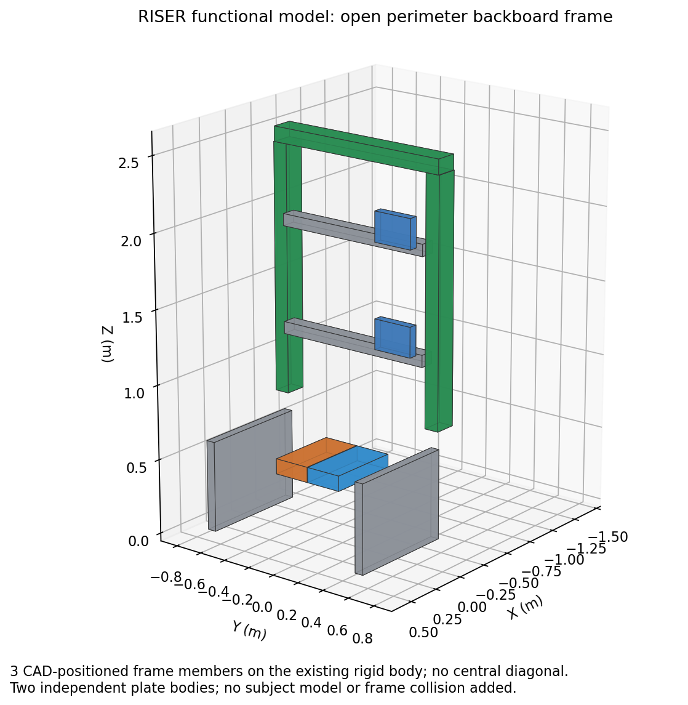

# RISER control

ROS 2 simulation and control interfaces for the RISER balance robot. The model
has independently driven backboard and foot-platform pitch, coordinated torso
and hip lateral slides, and two force plates. Gazebo applies physical joint
torques and forces, with gravity, inertia and plate contact enabled.



## Build

Requires Ubuntu 24.04, ROS 2 Jazzy and Gazebo Harmonic binary packages.
Build from the repository root:

```bash
source /opt/ros/jazzy/setup.bash
rosdep install --from-paths src --ignore-src -y
colcon build --cmake-args -DCMAKE_BUILD_TYPE=Release
source install/setup.bash
```

In each additional terminal, source ROS and `install/setup.bash`.

For the stock IgH G5 backend and laptop console, see the
[G5 commissioning checklist](reports/g5-motion-bringup.md).

## Explore

Start Gazebo with the position controller:

```bash
ros2 launch riser_bringup control.launch.py backend:=gazebo plot:=false
# Without the Gazebo GUI:
ros2 launch riser_bringup control.launch.py backend:=gazebo headless:=true plot:=false wrench_input:=false
```

Run one launch at a time; stop it with Ctrl+C before starting another. `plot:=false`
disables the optional PlotJuggler window, which launch otherwise opens by default.
`wrench_input:=false` disables the optional subject wrench GUI for headless runs.
For a kinematic preview with sliders, use
`ros2 launch riser_bringup view.launch.py`. For controller experiments without
physics, use `control.launch.py backend:=mock plot:=false`.

In a second sourced terminal, inspect the active controllers and move all three
coordinates slightly over five simulated seconds:

```bash
ros2 control list_controllers
ros2 topic pub --once /riser_position_controller/joint_trajectory trajectory_msgs/msg/JointTrajectory \
  '{joint_names: [backboard_pitch, foot_plate_pitch, ml_angle], points: [{positions: [0.02, -0.02, 0.01], time_from_start: {sec: 5}}]}'
ros2 topic echo --once /joint_states
ros2 topic echo --once /riser/force_plates/left/wrench
```

Commands use radians in the order `backboard_pitch`, `foot_plate_pitch`,
`ml_angle`; zero is the saved CAD pose. Position is the default command mode.
`command_mode:=velocity` selects the velocity controller, accepting a
`std_msgs/msg/Float64MultiArray` on `/riser_velocity_controller/commands` in the
same order, in rad/s. Send zeros to stop velocity commands. State feedback exposes
position, velocity and effort; `/riser/physical_joint_states` gives the actual
pitch and lateral-slide states used for TF.

## G5 motor calibration

The C++ calibration controller uses carriage position in metres and commands
velocity in m/s. The G5 launch configures it inactive. For the switch sequence,
shared limits, and passive GUI captures, see the
[G5 calibration procedure](src/riser_motion_bringup/README.md#calibration-and-balance).

## Simulated participant

Launch Gazebo with participant support while leaving the platform empty.

```bash
ros2 launch riser_bringup control.launch.py backend:=gazebo \
  human:=true \
  plot:=false wrench_input:=false
```

Add `headless:=true` for a numerical run. Wait for the platform to settle at its
starting pose before taring it empty. Then spawn the participant, measure its
mass, and capture the standing tare.

```bash
ros2 service call /ankle_wrench/tare std_srvs/srv/SetBool '{data: true}'
ros2 run riser_human_balance spawn_participant --pulse-nm 18
ros2 service call /ankle_wrench/measure_mass std_srvs/srv/Trigger '{}'
ros2 param get /ankle_wrench subject_mass_kg
ros2 service call /ankle_wrench/tare std_srvs/srv/SetBool '{data: false}'
```

Wait for each service to complete successfully. The participant is 1.70 m tall
and has 70 kg of Gazebo rigid-body mass. Its two visible feet form a single
rigid base welded to the left instrumented plate, so use the **summed** wrench
for weighing. The body has one sagittal ankle hinge. A pitch spring and damper
act between the body and board and leave the weight supported through the feet.
The footplate is held at its home pitch, and ML balance is outside this model.

Load the robot pendulum with the matching height, then switch from the position
controller. The participant starts ankle balance on the first physics step in
angular velocity mode.

```bash
ros2 run controller_manager spawner inverted_pendulum --inactive \
  --param-file "$(ros2 pkg prefix --share riser_human_balance)/config/pendulum.yaml"
ros2 control switch_controllers --strict \
  --deactivate riser_position_controller --activate inverted_pendulum
```

The ankle controller uses upright angle and angular velocity feedback. The
robot integrates the pendulum's backboard velocity with the controller period
and caps it at the configured backboard rate. The optional pulse adds ankle
torque for 0.65 simulated seconds to make recovery observable. Omit
`--pulse-nm` for an unperturbed start. To repeat from empty, restart the
launch. `human:=false` is the default.

```bash
gz topic -e -t /riser/human_balance
```

Telemetry reports simulation time, body pitch, backboard pitch, footplate pitch,
ankle torque, strap torque, and a balance-active flag, in that order. Angles are
in radians and torques are in N m.

To add a multisine or play a CSV torque signal while the participant balances,
follow the [AP perturbation tutorial](src/riser_bringup/config/perturbation-tutorial.md).
It includes the 25 Hz PlotJuggler stream and the ros2_control introspection example.

## Force plates and model details

The left and right `geometry_msgs/msg/WrenchStamped` topics are
`/riser/force_plates/left/wrench` and `/riser/force_plates/right/wrench`.
Frames are `left_force_plate` and `right_force_plate`, with origins at the plate
top-surface centres. Values use N and N m; positive Fz is upward support on the
plate. Readings include plate weight and inertia. Sensor timestamps use simulation
time; plate motion requires compensation before interpreting readings as subject
forces.

Controllers can also claim `left_force_plate/force.x` through
`left_force_plate/torque.z`, and the corresponding `right_force_plate` state
interfaces. Each sensor exposes `valid`
(1 for a finite sample within its configured `sample_timeout`, otherwise
0). Unavailable force/torque values are NaN. The state interfaces report force
and torque at the surface centres in physical axes `(y_gz, x_gz, -z_gz)`.
The wrench topics report in the Gazebo plate frames. See the [Gazebo interface reference](src/riser_gazebo/README.md#force-plate-state-interfaces).

Gazebo bringup also runs `ankle_wrench`, exporting the combined wrench at the
ankle midpoint in physical axes attached to the foot platform. Inspect all eight
output states on `/ankle_wrench_state_broadcaster/dynamic_joint_states`, including
`valid` and `sample_time`. Matrices, gains and moment arms are in
`src/riser_bringup/config/controllers.yaml`; see the
[parameter and frame reference](src/riser_bringup/config/README.md#ankle-wrench).
Factory calibration is kept separately in that directory and is bypassed for
simulated SI surface wrenches. Weight and inertia remain in the combined reading.

The Gazebo control wrapper supplies exact physics time to the hardware adapter.
`RiserSystem/read_time` supplies the single read-cycle timestamp on the combined
ankle wrench. ROS clock-message delivery does not determine hardware integration
intervals.

Physics uses a 1 ms step, the controller is configured for 1000 Hz, and each
force sensor defaults to 1000 Hz (`force_plate_rate:=...`). These are simulation
settings; wall-clock throughput and ROS delivery depend on rendering, contacts
and scheduling. Reduced pitch inertia uses acceleration delayed by one physics
step. Servo gains and travel bounds are provisional simulation parameters.
See [CAD model derivation](reports/model.md) for the geometry and dynamics.

The inverted-pendulum controller implements the backboard law. The real hardware launch uses the motion-inhibited G5 CSV profile by default.

## Development

| Path | Contents |
| --- | --- |
| `src/riser_bringup/` | Launch files, controllers, URDF/Xacro, model parameters, worlds and state adapters. |
| `src/riser_gazebo/` | Physical actuation and reduced pitch dynamics. |
| `src/riser_hardware/` | IgH G5 CSV backend and actuator-mapping helpers. |
| `src/riser_subject_simulation/` | Subject wrench world plugin, ROS bridge input and optional GUI. |
| `src/riser_human_balance/` | Spawnable participant, sagittal ankle balance and pitch coupling. |
| `evidence/` | Small offline linkage and actuator-mapping references. |

[Configuration reference](src/riser_bringup/config/README.md) identifies
the runtime settings. [Offline model references](evidence/README.md) describe
the retained mapping data.

From the repository root, run the model/interface checks after building:

```bash
colcon test
colcon test-result --verbose
```

