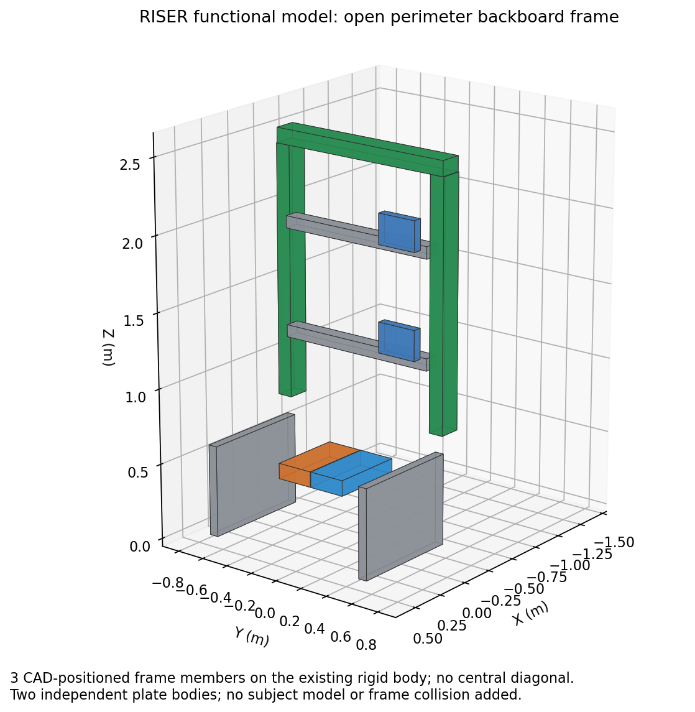

# CAD model derivation

The model is derived from the SolidWorks assembly `UBC Riser/Riser 11-19-19`,
using its saved operating placements and the Vertical floor/AP connector
configurations. Coordinates map as ROS `(x, y, z) = (CAD z, CAD x, CAD y + 0.6477 m)`.
The mapping evidence retains that saved CAD pose. Operational zero now means
vertical backboard, flat footplate and carriage contact centres above the
force-plate ML midpoint. `kinematics.yaml` supplies the fixed CAD-to-neutral
coordinate offsets; these are separate from session encoder calibration.

CAD placements supply joint axes, setup heights and contact-surface locations.
Primitive visuals represent the frame and carriages; collisions cover the two
carriages and two plates. These shapes simplify appearance and contact geometry
independently of the CAD-derived rigid-body inertias. Torso and hip setup heights
are fixed. Their lateral motion follows `y_i = h_i tan(ml_angle)`, with
`h_torso = 1.348575 m` and `h_hip = 0.621500 m`. The reported ML angle fits both
measured slide positions.

Mass, centre of mass and full inertia tensors were aggregated from disjoint CAD
part instances, rotated into each link frame and combined with the parallel-axis
theorem. SolidWorks products of inertia were negated for URDF off-diagonal entries
before rotation. The foot assembly is partitioned into a 42.4214 kg support and
two 29.4327 kg sensing plates, preserving assembly mass, COM and inertia.
Some CAD materials and vendor-part densities are estimates; the parameters are
not calibrated against weighed hardware.

Gazebo drives the two pitch joints directly. The omitted linear pitch stages and
connecting rods contribute through `reduced_pitch.json`: angle-dependent inertia
`M(q)`, its derivative, gravity torque `Qg(q)` and damping `D(q)`. The additional
pitch torque is `Qg - 0.5 M'(q) qdot² - D qdot - M qddot`. Acceleration comes from
the preceding physics-step velocity difference, giving a 1 ms delay at the default
step; impulsive contact is therefore approximate. The reduction assumes an
anchored base and vertical gravity of 9.80665 m/s². It does not reconstruct
removed-body bearing loads or free-base reactions.

Model files live in
[`src/riser_bringup/urdf/model`](../src/riser_bringup/urdf/model).
Plate properties are defined in `urdf/riser.urdf.xacro`. Offline
[actuator mappings and linkage geometry](../evidence/README.md) retain the CAD
pin geometry for mapping work. Source CAD and extraction/table-generation tools
are not bundled; changes to linkage geometry or gravity require recomputing the
reduced dynamics. The tables still span only CAD q = +/-0.08 rad. Wider measured
travel currently uses endpoint-held coefficients after converting operational
pitch to CAD q. This enables the enlarged geometric envelope with approximate
dynamics, not validated full-travel inertial accuracy. Damping, servo gains and operating limits remain simulation
parameters. Participant mechanics and counterbalance spring laws are not modelled.

The [motion-envelope audit](motion-envelope.md) distinguishes plate-footprint
bounds, CAD versus centred joint zeros, measured actuator stops, and the current
reduced-dynamics table domain. Applied travel limits come from approximate user-measured strokes and canonical
linkage geometry; speed and effort settings remain provisional. The audit also
contains a Windows/CAD resampling task prompt.
